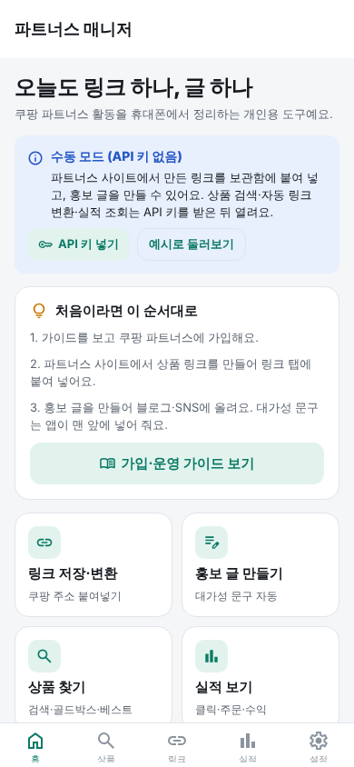
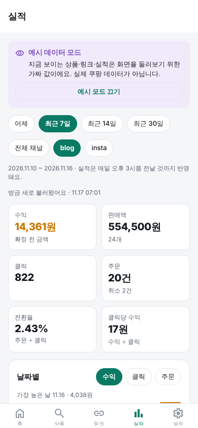

# 파트너스 매니저 — 쿠팡 파트너스 운영 앱

쿠팡 파트너스에 가입한 뒤 **휴대폰 하나로 링크 저장 → 홍보 글 만들기 → 실적 확인**까지 하는 개인용 앱입니다. Expo(React Native)로 만들어 안드로이드·아이폰·**웹사이트**에서 같은 코드로 돌아갑니다.

| 쓰는 곳 | 주소·방법 | 쿠팡 API (상품 검색·자동 변환·실적) |
|---|---|---|
| 웹 (바로 쓰기) | [claude.ai 아티팩트](https://claude.ai/artifact/VnNDvs78rQ5umauu2Ggoqh) — 본인만 열 수 있는 비공개 페이지 | 안 됨 (수동·예시 모드) |
| 웹 (내 웹사이트) | Vercel에 무료 배포 → `https://<이름>.vercel.app` ([아래](#웹사이트로-쓰기)) | 됨 |
| 휴대폰 앱 | Expo Go 또는 안드로이드 APK ([아래](#휴대폰에서-실행하기)) | 됨 |

> 쿠팡이 만든 공식 앱이 아닙니다. 약관·승인 조건·정산 기준은 항상 [쿠팡 파트너스 사이트](https://partners.coupang.com/)가 우선입니다.

| 홈 (수동 모드) | 홍보 글 만들기 | 상품 찾기 (예시 데이터) | 실적 (예시 데이터) |
|---|---|---|---|
|  |  |  |  |

## 무엇을 할 수 있나

| 탭 | 기능 | API 키 필요 |
|---|---|---|
| 홈 | 오늘의 할 일 체크리스트, 최근 7일 수익 요약, 최근 링크 | 요약만 필요 |
| 링크 | 파트너스 링크 붙여넣기·저장, 일반 쿠팡 주소 경고, (API) 쿠팡 주소 → 파트너스 짧은 링크 자동 변환, 채널 ID 표시, **자비스로 보내기**(CSV 복사), CSV 내보내기 | 자동 변환만 필요 |
| 짧은 홍보 글 | 블로그·인스타그램·카톡·스레드용 홍보 글 자동 작성. **대가성 문구를 맨 앞에 넣고, 빠지면 복사를 막음** | 아니요 |
| 네이버 상품 추천 | 자비스 🛒 '가장 핫한 물품'과 같은 셈법(쿠팡 순위 45 + 네이버 뜨는 분야 25 + 이달의 말 15 + 영상거리 15)으로 상품 후보 점수·이유 보기, 분야별 클릭 추이(최근 7일 ÷ 앞 21일) | 네이버 API HUB(뜨는 분야), 쿠팡 키 또는 네이버 쇼핑 검색 키(상품 후보) |
| 블로그 소개 글 | 자비스 '블로그 자동발행기'의 상품 소개 글 방식: 상품 정보·메모만 근거로 AI가 쓰고 → **앱이 검사**(없는 숫자·써 본 척·과장·연예인·광고 말) → 한 번 고치게 하고 → 그래도 남으면 그 문장을 뺌. 광고 고지·구매 링크·가격 기준일·"직접 써 본 후기 아님"은 앱이 붙임 | 아니요 (AI는 아래 참고) |
| 홍보 영상 | 자비스 제품 릴스 방식: 3초 훅 → 컷마다 흰 박스 자막 + 노란 강조 → 구매 안내, 모든 장면에 '광고'·수수료 고지. 대본 검사 통과 뒤 **브라우저에서 1080×1920 세로 영상(mp4/webm, 무음)** 을 만들고 인스타 캡션·유튜브 제목·설명(광고 표시 첫 줄, 해시태그 5개)을 줌 | 아니요 (영상 파일은 웹에서만) |
| 상품 | 키워드 검색, 골드박스, 카테고리 베스트 19종, 쿠팡 PL → 링크 복사·보관함 저장·글 만들기 | 예 |
| 실적 | 어제·7·14·30일 수익, 판매액, 클릭, 주문, 취소, 전환율, 클릭당 수익, 날짜별 그래프, 잘 팔린 상품, 채널별 성과 | 예 |
| 설정 | API 키(휴대폰 보안 저장소), **네이버 API 키**(API HUB 쇼핑인사이트 / 개발자센터 쇼핑 검색, 연결 확인), 글쓴이 이름·영상 끝 안내 방식, 시간당 호출 한도, 채널 ID(subId), **내 채널**(파트너스에 등록한 웹사이트·블로그, 홈에서 바로 열기·인스타 프로필 링크 안내), 대가성 문구, 예시 데이터 모드, 데이터 지우기 | — |
| 가이드 | 가입 → 첫 링크 → 글 올리기 → 승인·API 키 → 하지 말아야 할 것 → 실적 키우기 | — |

### 세 가지 모드

- **수동 모드 (가입 직후 기본)**: API 키가 없어도 씁니다. 파트너스 사이트에서 만든 링크를 붙여 넣어 보관하고, 홍보 글을 만듭니다. 일반 쿠팡 주소를 붙여 넣으면 "수익이 안 잡힌다"고 경고합니다.
- **API 모드**: 설정 탭에 Access Key·Secret Key를 넣으면 상품 검색, 자동 링크 변환, 실적 조회가 열립니다.
- **예시 데이터 모드**: 키 없이 상품·실적 화면을 가짜 값으로 둘러봅니다. 화면마다 "예시"라고 표시하고, 예시 링크는 쿠팡 주소처럼 보이지 않게 `example.com`을 씁니다.

## 웹사이트로 쓰기

### 1) 바로 쓰기: Claude 아티팩트

<https://claude.ai/artifact/VnNDvs78rQ5umauu2Ggoqh> — claude.ai에 로그인한 본인만 열 수 있습니다 (PC 브라우저, 휴대폰 브라우저, Claude 앱).

- 링크 보관함, 홍보 글 만들기, 오늘의 할 일, 가이드, 예시 데이터 모드를 씁니다.
- 링크·설정은 **내 Claude 계정의 개인 저장소**에 저장돼서 다른 기기에서 열어도 그대로 보이고, 공유해도 다른 사람에게는 보이지 않습니다.
- 이 화면은 보안상 바깥 서버로 요청을 보낼 수 없어서 **쿠팡·네이버 API(상품 검색·자동 링크 변환·실적·뜨는 분야)는 쓸 수 없습니다.** 키 입력칸도 숨겨 둡니다.
- 대신 **블로그 소개 글·영상 대본을 Claude가 바로 씁니다** (아티팩트의 Claude 호출 기능 — 보는 사람의 Claude 사용량을 쓰고, 처음 한 번 허락을 묻습니다). 만든 영상은 아티팩트의 파일 저장 기능으로 내려받습니다(저장 전에 확인 창).
- 앱을 고친 뒤 다시 올리려면 `node scripts/build-artifact.mjs`로 `dist-artifact/`를 만들고, Claude에게 이 아티팩트를 업데이트해 달라고 하세요.

### 2) 내 웹사이트로 배포하기 (Vercel, API까지)

브라우저는 보안 규칙(CORS) 때문에 쿠팡·네이버 API를 직접 부르지 못할 수 있어서, 웹사이트에는 작은 중계 함수(`api/coupang.js`, `api/naver.js`)가 같이 올라갑니다. 네이버 중계는 쇼핑인사이트(`POST /shopping/v1/categories`)와 쇼핑 검색(`GET /v1/search/shop.json`) 두 주소만 전달하고, 키 헤더를 그대로 넘길 뿐 저장하지 않습니다. 서명은 브라우저에서 끝내고, 중계는 서명된 요청을 쿠팡 파트너스 API 경로로만 그대로 전달합니다. **Secret Key는 브라우저 밖으로 나가지 않고**, 중계는 아무것도 저장하지 않습니다.

1. [vercel.com](https://vercel.com/signup)에 GitHub 계정으로 가입합니다. 무료 Hobby 요금제는 개인·비상업 용도 조건이 있으니, 수익 활동에 쓰는 것이 괜찮은지 Vercel 약관을 확인하세요 (Netlify, Cloudflare Pages 같은 다른 곳도 함수만 옮기면 됩니다).
2. **Add New → Project** → 이 저장소(`factory`)의 **Import**.
3. **Root Directory**를 `coupang-partners-app`으로 바꿉니다. 빌드 설정은 `vercel.json`이 채우니 그대로 둡니다.
4. **Deploy** → 몇 분 뒤 `https://<프로젝트이름>.vercel.app` 주소가 나옵니다.
5. 그 주소의 **설정** 탭에서 API 키를 넣고 **연결 확인**을 누릅니다.

- Vercel은 기본 브랜치를 실제 주소로 배포합니다. 이 앱이 아직 기본 브랜치에 합쳐지지 않았다면, PR을 합치거나 Vercel 프로젝트 설정의 Production Branch를 이 브랜치로 바꾸세요.
- 웹사이트 주소를 아는 사람은 화면을 열 수 있지만, 키와 링크 보관함은 각자 브라우저에만 저장됩니다. 공용 PC에서는 키를 넣지 마세요.
- 휴대폰 홈 화면에 추가하면 앱처럼 쓸 수 있습니다 (사파리: 공유 → 홈 화면에 추가 / 크롬: 메뉴 → 홈 화면에 추가).

## AI로 쓰기 (블로그 소개 글·영상 대본)

| 어디서 | 방법 |
|---|---|
| Claude 아티팩트 | **✨ Claude로 쓰기** 버튼 한 번. 쓰고 → 검사 → 걸리면 자동으로 한 번 고침 |
| 휴대폰 앱·내 웹사이트 | **1. 프롬프트 복사** → Claude 앱(또는 다른 AI)에 붙여 넣기 → 받은 답 전체를 붙여 넣고 **2. 검사하기**. 걸리면 '고칠 점 프롬프트'를 같은 대화에 붙여 넣고 새 답을 다시 붙여 넣기 |

앱 안에 AI 키를 넣지 않습니다. 검사(없는 숫자·써 본 척·효능 단정·근거 없는 최저가/1위·연예인 이름·광고 말)는 어느 길이든 앱이 똑같이 합니다 (`src/lib/productRules.ts` — 자비스 `shop_reel.py`·`blog_hotissue.py`와 같은 규칙). 숫자는 상품 정보(이름·가격·순위·카테고리)와 **내가 적은 메모**에 있는 것만 쓸 수 있어서, 상품 페이지에서 확인한 구성·용량·일정을 메모에 적어 두면 글이 풍성해집니다.

영상은 상품 사진(직접 올린 것)에 자막을 얹어 브라우저에서 녹화합니다. 소리는 없습니다 — 음악·목소리는 인스타·유튜브 편집기에서 넣으세요 ('목소리 대본'을 복사해 쓸 수 있습니다). 자비스 PC의 Opus 모션 릴스(목소리·모션 그래픽)와 같은 품질은 아니고, 같은 대본 규칙·화면 배치의 간단한 판입니다.

## 자비스와 함께 쓰기

찰스님 PC의 자비스(`kcs880323-crypto/jarvis`)는 🛒 '내 제휴 상품 → 📥 파트너스 매니저에서 가져오기'로 이 앱의 링크를 받습니다 (`shop_connect.import_csv`).

1. 앱 **링크 탭 → 자비스로 보내기**(또는 설정 → 🤖 자비스와 함께 쓰기). 파트너스 링크만 자비스 형식 CSV(`이름,링크,가격,채널,메모,저장일`)로 복사됩니다. 예시 링크·일반 쿠팡 주소는 빠집니다.
2. 자비스 🛒 → 🔗 내 제휴 상품 → 📥 파트너스 매니저에서 가져오기에 붙여 넣습니다. 같은 링크는 두 번 들어가지 않고 비어 있던 칸만 채웁니다.
3. 찰스의 추천템에 올리기·빼기, 제품 릴스, 상품 소개 글은 자비스에서 합니다 (공개되는 일은 자비스 확인 뒤에만).

앱이 만든 CSV를 자비스의 실제 가져오기 코드에 넣어 확인했습니다 (2개 추가, 다시 넣으면 0개 추가, 따옴표·쉼표·줄바꿈이 든 메모 그대로).

## 추천 페이지: 쿠팡 파트너스에 등록할 채널 주소

쿠팡 파트너스 가입 양식은 **링크를 올릴 내 채널의 주소**(블로그, 웹사이트, SNS, 유튜브, 모바일 앱)를 묻습니다. 이 앱(파트너스 매니저)은 나만 쓰는 관리 도구라서 채널이 아닙니다. 그래서 추천 상품을 올리는 공개 페이지 **찰스의 추천템**을 따로 만들어 두었습니다 (저장소의 `docs/` 폴더).

- 주소: **https://kcs880323-crypto.github.io/factory/**
- 가입 양식에서는 채널 종류를 **웹사이트**로 고르고 위 주소를 넣으세요. "모바일 앱"을 고르면 보통 앱스토어 주소를 요구합니다.
- 대가성 문구가 페이지 맨 위에 늘 보이고, 상품 링크에는 `rel="sponsored"`가 붙습니다.
- 인스타그램 캡션의 "구매 링크는 프로필 링크에서"의 그 프로필 링크로도 쓰면 됩니다.

### 처음 한 번: 페이지 켜기 (GitHub Pages)

1. GitHub에서 이 저장소 → **Settings** → 왼쪽 **Pages**.
2. **Build and deployment → Source**: `Deploy from a branch`.
3. **Branch**: `claude/jarvis-skills-delivery-75yvpx`, 폴더 `/docs` → **Save**.
4. 1~2분 뒤 위 주소가 열립니다. (저장소가 공개라서 무료입니다.)

### 상품 올리기

`docs/products.json`의 `products`에 한 줄씩 넣습니다. 파트너스 링크(`link.coupang.com/a/…`, `coupa.ng/…`)가 아닌 주소는 페이지에 나오지 않습니다.

```json
{
  "title": "캡형 물티슈 100매 10팩",
  "url": "https://link.coupang.com/a/xxxxxx",
  "category": "생활",
  "note": "뚜껑이 있어서 끝까지 마르지 않아요.",
  "price": 15900,
  "added": "2026-11-17"
}
```

- `title`, `url`은 꼭 넣고, 나머지는 빼도 됩니다. `price`를 넣으면 `added` 날짜 기준 가격으로 표시됩니다. `"hidden": true`를 넣으면 지우지 않고 숨깁니다.
- 직접 고치기 어렵다면 Claude에게 "이 링크 추천 페이지에 올려줘"라고 링크·이름·한 줄 소개를 주면 됩니다.
- 페이지 이름·소개 문구·유튜브/인스타 주소는 같은 파일의 `site`에서 바꿉니다 (`links`: `[{"label": "유튜브", "url": "https://..."}]`).
- 후기나 장점은 직접 써 보고 확인한 것만 적어 주세요. 써 보지 않은 후기를 지어내는 것은 표시광고법 위반이 될 수 있습니다.

## 휴대폰에서 실행하기

PC(윈도우는 Git Bash 또는 PowerShell)에 [Node.js](https://nodejs.org/) 20 이상이 필요합니다.

```bash
cd coupang-partners-app
npm install
npx expo start
```

1. 휴대폰에 **Expo Go** 앱을 설치합니다 (구글 플레이 / 앱스토어).
2. 터미널에 나온 QR 코드를 안드로이드는 Expo Go로, 아이폰은 기본 카메라로 찍습니다.
3. PC와 휴대폰이 같은 와이파이에 있어야 합니다. 안 되면 `npx expo start --tunnel`.

이 앱이 쓰는 모듈(보안 저장소, 클립보드, 저장소)은 모두 Expo Go에 들어 있어서 따로 빌드하지 않아도 됩니다. Expo Go는 최신 SDK만 지원하므로, 오래 뒤에 다시 쓸 때 "SDK 버전이 맞지 않는다"고 나오면 `npx expo install --fix`로 버전을 맞추세요 (현재 SDK 58).

### 안드로이드에 설치 파일(APK)로 깔기

PC를 켜 두지 않고 쓰려면 APK를 만듭니다. 무료 [Expo 계정](https://expo.dev/signup)이 필요합니다.

```bash
npx eas-cli@latest login
npx eas-cli@latest build -p android --profile preview
```

빌드가 끝나면 나오는 링크(또는 QR)로 APK를 받아 설치합니다. 처음 한 번은 "출처를 알 수 없는 앱 설치"를 허용해야 합니다. `app.json`의 패키지 이름 `com.example.partnersmanager`는 스토어에 올릴 때 본인 것으로 바꾸세요.

아이폰에 독립 앱으로 설치하거나 스토어에 올리려면 Apple 개발자 계정(유료)이 필요합니다. 개인용으로는 Expo Go로 충분합니다.

## 쿠팡 파트너스 연결 순서

1. [파트너스 사이트](https://partners.coupang.com/)에 쿠팡 계정으로 가입하고, 활동 채널(블로그·SNS 주소)을 등록합니다.
2. 사이트에서 상품 링크를 만들어 앱의 **링크 탭 → 붙여넣기**로 저장합니다.
3. **글 만들기**로 홍보 글을 만들어 올립니다. 대가성 문구는 앱이 글 맨 앞에 넣습니다 (공정위 추천·보증 심사지침, 2024.12.1 시행: 제목이나 첫 부분에 표시).
4. 활동이 쌓여 최종 승인을 받으면 파트너스 사이트의 파트너스 API 메뉴에서 키를 받습니다. 공개 자료에는 "누적 판매액 15만 원 이상이면 승인 심사"라고 알려져 있지만 공식 문서로 확인하지는 못했습니다. 사이트 공지를 확인하세요.
5. 앱 **설정 탭**에 키를 넣고 **연결 확인**(API 1회)을 누릅니다.
6. 블로그·인스타그램 등 채널마다 다른 채널 ID(subId)를 등록해 두면 실적 탭에서 채널별 성과를 나눠 볼 수 있습니다.

## 계정 보호: 호출 한도

네이버 호출은 따로 셉니다: 시간당 60회까지, 같은 추천 조합은 6시간 동안 저장된 결과를 다시 씁니다 (쇼핑인사이트는 하루 1,000회로 알려져 있음).

쿠팡은 짧은 시간에 API 호출이 몰리면 계정을 24시간 정지하고, 반복되면 영구 정지할 수 있다고 알려져 있습니다. 공개된 수치는 자료마다 다릅니다 (검색 분당 50회, 리포트 시간당 500회, "시간당 약 30회를 넘으면 정지" 경험담). 그래서 앱은:

- **최근 1시간 호출 수가 한도(기본 30회)에 닿으면 요청을 보내지 않습니다.** 설정에서 5~200회로 바꿀 수 있습니다.
- 같은 검색어·목록·리포트는 **1시간 동안 저장된 결과**를 다시 보여 줍니다 (호출 없음). 아래로 당기면 새로 부릅니다.
- 홈 화면은 API를 부르지 않고, 실적 탭에서 불러온 값만 보여 줍니다.
- 실적 1회 조회 = 리포트 4종(클릭·주문·취소·수익) = 최소 4회 호출.

## 보안

- API 키는 휴대폰의 보안 저장소(`expo-secure-store`: 안드로이드 Keystore, iOS Keychain)에만 저장되고, 쿠팡 API 서버 말고는 어디로도 보내지 않습니다.
- 요청 서명(HMAC-SHA256)은 휴대폰 안에서 계산합니다. 별도 서버가 없습니다.
- 링크 보관함과 설정은 휴대폰 안(AsyncStorage)에만 있습니다. 휴대폰을 바꾸기 전에 **설정 → 링크 보관함 내보내기(CSV)** 로 옮기세요.
- 웹사이트(Vercel)에는 보안 저장소가 없어서 키가 그 브라우저 저장소에 들어갑니다. Claude 아티팩트 화면에는 키를 넣지 않습니다(입력칸 없음).
- `npx expo start --web`으로 PC에서 띄운 화면에는 중계 함수가 없어서 API를 부르면 "중계 서버가 없어요"라고 안내합니다. API까지 시험하려면 Vercel에 올리거나 `npx vercel dev`를 쓰세요.

## 개발

```bash
npm test          # 서명·쿠팡/네이버 클라이언트·웹 중계·추천 점수·상품 글/영상 대본 검사·날짜·리포트·글 템플릿·호출 한도 (57개)
npm run typecheck # tsc
npm run lint      # ESLint (eslint-config-expo)
```

```
app/                  화면 (Expo Router)
  (tabs)/             홈·상품·링크·실적·설정 탭
  compose.tsx         짧은 홍보 글 만들기
  recommend.tsx       네이버 상품 추천
  post.tsx            블로그 소개 글 (자비스 방식)
  reel.tsx            홍보 영상 (자비스 방식)
  guide.tsx           가입·운영 가이드
src/api/              쿠팡 파트너스 Open API: 서명(signature.ts), 클라이언트(client.ts), 응답 타입 / 네이버(naver.ts)
src/lib/naverTrend.ts 추천 셈법 (자비스 shop_sources.hot과 같음)
src/lib/productRules.ts·productPost.ts·productReel.ts  상품 글·영상 대본 규칙·검사·완성 (자비스와 같은 선)
src/lib/ai.ts         아티팩트의 Claude 호출(sample)
src/video/            영상: 장면 그리기(reelDraw.ts), 녹화(record.ts), 화면(ReelStudio.web.tsx — 휴대폰 앱은 안내만)
src/lib/              날짜(KST), 리포트 요약, 글 템플릿·대가성 문구, 링크 판별, 호출 한도
src/store/            앱 상태(AppContext), 저장소, 호출 기록(callBudget.ts)
src/demo/             예시 데이터 모드용 가짜 클라이언트
src/ui/               테마·공통 부품 (icon.tsx / icon.web.tsx 처럼 웹만 다른 파일은 .web 접미사)
src/lib/hosting.ts    휴대폰 앱 / 웹사이트 / Claude 아티팩트 구분
src/store/artifactDb.ts  아티팩트 화면에서 링크·설정을 개인 저장소에 두는 부분
api/coupang.js        웹사이트용 쿠팡 API 중계 (Vercel 함수)
api/naver.js          웹사이트용 네이버 API 중계 (쇼핑인사이트·쇼핑 검색만)
scripts/build-artifact.mjs  Claude 아티팩트용 빌드
vercel.json           Vercel 빌드 설정
tests/                node:test + tsx
```

API 요점 (`src/api/client.ts`):

- 주소 `https://api-gateway.coupang.com/v2/providers/affiliate_open_api/apis/openapi/v1`
- `Authorization: CEA algorithm=HmacSHA256, access-key=…, signed-date=yyMMddTHHmmssZ(UTC), signature=hex(HMAC-SHA256(secret, signed-date + 메서드 + 경로 + 쿼리))`
- 401은 키 오류나 휴대폰 시계 어긋남, 403은 API 미승인·일시 정지, 429는 호출 초과. 200이어도 `rCode`가 `0`이 아니면 실패로 처리합니다 (예: 판매 종료 상품의 딥링크 → `url convert failed`).

## 확인한 것과 못 한 것

- 확인함: 단위 테스트 31개 통과 (서명을 Node 표준 crypto와 대조, 가짜 쿠팡 게이트웨이 서버로 요청 경로·쿼리·본문·서명·오류 처리·리포트 페이지 넘김·호출 한도 확인, 웹 중계를 거쳐도 서명이 그대로 통과하고 Secret Key가 중계로 가지 않는지 확인), 타입 검사·린트 통과, 안드로이드·iOS 자바스크립트 번들 생성, 웹 빌드를 휴대폰 크기 브라우저에서 눌러 보며 화면·흐름 확인 (수동 모드 링크 저장 → 글 만들기 → 문구 복구, 예시 모드 상품·실적, 다크 모드).
- 웹사이트: Vercel처럼 정적 파일 + 중계 함수를 띄우고 그 뒤에 가짜 쿠팡을 둔 채로 브라우저에서 키 입력 → 연결 확인 → 검색 → 보관함 저장(짧은 링크) → 쿠팡 주소 변환 → 삭제 확인창 → 실적 → 공유(복사로 대체)까지 확인.
- 아티팩트: 다른 경로·iframe 안·엄격한 보안 정책(외부 요청·글꼴 주소 차단, `confirm()` 막힘, 클립보드 읽기 거부)과 가짜 개인 저장소로 흉내 내서 부팅·탭 이동·아이콘·저장·브라우저 저장소를 지운 뒤 다시 불러오기·삭제 확인창·다크 모드를 확인. 실제 claude.ai 화면에서 직접 열어 보지는 못했습니다.
- 네이버·AI·영상 (2026-11-17): 가짜 네이버 서버로 키 헤더·요청 본문·중계 허용 목록(그 밖의 주소 400)·틀린 키 안내(키 값은 안 보임)를 테스트로 확인. 웹사이트 흉내(중계 + 가짜 쿠팡·네이버)에서 네이버 키 저장 → 연결 확인 → 추천(점수·이유·뜨는 분야) → 블로그 글(붙여 넣기 방식, 첫 답의 경험담·없는 숫자가 걸리고 고친 뒤에도 남은 2문장이 빠짐, 광고 고지 맨 앞·표 뒤 링크) → 영상 대본 → 사진 올리기 → 녹화(H.264 mp4 1080×1920, 18.8초) → 내려받기까지 확인. 아티팩트 흉내(가짜 Claude 호출·파일 저장)에서 Claude 버튼 → 자동으로 한 번 고침 → 완성, 영상 녹화 → 파일 저장 기능으로 저장까지 확인 (엄격한 보안 정책에서는 페이지 안 재생이 막혀 '저장해서 보세요'로 안내).
- 못 함: **실제 네이버 API 호출**(이 환경에서 네이버에 닿지 않음 — 자비스가 같은 키·주소로 쇼핑인사이트를 실제로 받은 것은 확인된 사실), **실제 Claude 아티팩트에서 Claude 호출·파일 저장**, 실제 AI가 쓴 글·대본의 품질, 휴대폰 사파리에서의 녹화, **실제 쿠팡 API 호출** (키가 없고 이 개발 환경에서 쿠팡 서버에 닿지 않음), **실제 휴대폰에서 실행** (Expo Go·APK 설치 시험 안 함), **실제 Vercel 배포** (계정 필요). 키를 받은 뒤 처음 쓸 때 설정 탭의 "연결 확인"으로 먼저 확인하세요. 응답 필드가 문서와 달라 화면 숫자가 이상하면 알려 주세요.

## 참고한 자료

- 쿠팡 파트너스 Open API 도움말: partners.coupang.com (`#help/open-api`)
- 공개 오픈소스 구현의 API 정리와 실측 메모: npm `n8n-nodes-coupang-partners`, `coupang-partners-sdk-standalone`
- 공정거래위원회 「추천·보증 등에 관한 표시·광고 심사지침」 개정 (2024.12.1 시행) 해설 자료
