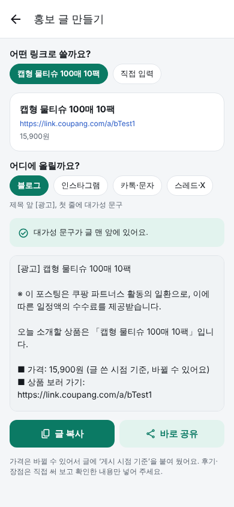
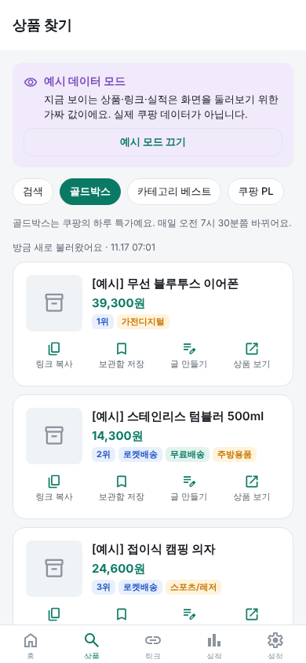

# 파트너스 매니저 — 쿠팡 파트너스 운영 앱

쿠팡 파트너스에 가입한 뒤 **휴대폰 하나로 링크 저장 → 홍보 글 만들기 → 실적 확인**까지 하는 개인용 앱입니다. Expo(React Native)로 만들어 안드로이드·아이폰에서 같은 코드로 돌아갑니다.

> 쿠팡이 만든 공식 앱이 아닙니다. 약관·승인 조건·정산 기준은 항상 [쿠팡 파트너스 사이트](https://partners.coupang.com/)가 우선입니다.

| 홈 (수동 모드) | 홍보 글 만들기 | 상품 찾기 (예시 데이터) | 실적 (예시 데이터) |
|---|---|---|---|
|  |  |  |  |

## 무엇을 할 수 있나

| 탭 | 기능 | API 키 필요 |
|---|---|---|
| 홈 | 오늘의 할 일 체크리스트, 최근 7일 수익 요약, 최근 링크 | 요약만 필요 |
| 링크 | 파트너스 링크 붙여넣기·저장, 일반 쿠팡 주소 경고, (API) 쿠팡 주소 → 파트너스 짧은 링크 자동 변환, 채널 ID 표시, CSV 내보내기 | 자동 변환만 필요 |
| 글 만들기 | 블로그·인스타그램·카톡·스레드용 홍보 글 자동 작성. **대가성 문구를 맨 앞에 넣고, 빠지면 복사를 막음** | 아니요 |
| 상품 | 키워드 검색, 골드박스, 카테고리 베스트 19종, 쿠팡 PL → 링크 복사·보관함 저장·글 만들기 | 예 |
| 실적 | 어제·7·14·30일 수익, 판매액, 클릭, 주문, 취소, 전환율, 클릭당 수익, 날짜별 그래프, 잘 팔린 상품, 채널별 성과 | 예 |
| 설정 | API 키(휴대폰 보안 저장소), 시간당 호출 한도, 채널 ID(subId), 대가성 문구, 예시 데이터 모드, 데이터 지우기 | — |
| 가이드 | 가입 → 첫 링크 → 글 올리기 → 승인·API 키 → 하지 말아야 할 것 → 실적 키우기 | — |

### 세 가지 모드

- **수동 모드 (가입 직후 기본)**: API 키가 없어도 씁니다. 파트너스 사이트에서 만든 링크를 붙여 넣어 보관하고, 홍보 글을 만듭니다. 일반 쿠팡 주소를 붙여 넣으면 "수익이 안 잡힌다"고 경고합니다.
- **API 모드**: 설정 탭에 Access Key·Secret Key를 넣으면 상품 검색, 자동 링크 변환, 실적 조회가 열립니다.
- **예시 데이터 모드**: 키 없이 상품·실적 화면을 가짜 값으로 둘러봅니다. 화면마다 "예시"라고 표시하고, 예시 링크는 쿠팡 주소처럼 보이지 않게 `example.com`을 씁니다.

## 휴대폰에서 실행하기

PC(윈도우는 Git Bash 또는 PowerShell)에 [Node.js](https://nodejs.org/) 20 이상이 필요합니다.

```bash
cd coupang-partners-app
npm install
npx expo start
```

1. 휴대폰에 **Expo Go** 앱을 설치합니다 (구글 플레이 / 앱스토어).
2. 터미널에 나온 QR 코드를 안드로이드는 Expo Go로, 아이폰은 기본 카메라로 찍습니다.
3. PC와 휴대폰이 같은 와이파이에 있어야 합니다. 안 되면 `npx expo start --tunnel`.

이 앱이 쓰는 모듈(보안 저장소, 클립보드, 저장소)은 모두 Expo Go에 들어 있어서 따로 빌드하지 않아도 됩니다. Expo Go는 최신 SDK만 지원하므로, 오래 뒤에 다시 쓸 때 "SDK 버전이 맞지 않는다"고 나오면 `npx expo install --fix`로 버전을 맞추세요 (현재 SDK 58).

### 안드로이드에 설치 파일(APK)로 깔기

PC를 켜 두지 않고 쓰려면 APK를 만듭니다. 무료 [Expo 계정](https://expo.dev/signup)이 필요합니다.

```bash
npx eas-cli@latest login
npx eas-cli@latest build -p android --profile preview
```

빌드가 끝나면 나오는 링크(또는 QR)로 APK를 받아 설치합니다. 처음 한 번은 "출처를 알 수 없는 앱 설치"를 허용해야 합니다. `app.json`의 패키지 이름 `com.example.partnersmanager`는 스토어에 올릴 때 본인 것으로 바꾸세요.

아이폰에 독립 앱으로 설치하거나 스토어에 올리려면 Apple 개발자 계정(유료)이 필요합니다. 개인용으로는 Expo Go로 충분합니다.

## 쿠팡 파트너스 연결 순서

1. [파트너스 사이트](https://partners.coupang.com/)에 쿠팡 계정으로 가입하고, 활동 채널(블로그·SNS 주소)을 등록합니다.
2. 사이트에서 상품 링크를 만들어 앱의 **링크 탭 → 붙여넣기**로 저장합니다.
3. **글 만들기**로 홍보 글을 만들어 올립니다. 대가성 문구는 앱이 글 맨 앞에 넣습니다 (공정위 추천·보증 심사지침, 2024.12.1 시행: 제목이나 첫 부분에 표시).
4. 활동이 쌓여 최종 승인을 받으면 파트너스 사이트의 파트너스 API 메뉴에서 키를 받습니다. 공개 자료에는 "누적 판매액 15만 원 이상이면 승인 심사"라고 알려져 있지만 공식 문서로 확인하지는 못했습니다. 사이트 공지를 확인하세요.
5. 앱 **설정 탭**에 키를 넣고 **연결 확인**(API 1회)을 누릅니다.
6. 블로그·인스타그램 등 채널마다 다른 채널 ID(subId)를 등록해 두면 실적 탭에서 채널별 성과를 나눠 볼 수 있습니다.

## 계정 보호: 호출 한도

쿠팡은 짧은 시간에 API 호출이 몰리면 계정을 24시간 정지하고, 반복되면 영구 정지할 수 있다고 알려져 있습니다. 공개된 수치는 자료마다 다릅니다 (검색 분당 50회, 리포트 시간당 500회, "시간당 약 30회를 넘으면 정지" 경험담). 그래서 앱은:

- **최근 1시간 호출 수가 한도(기본 30회)에 닿으면 요청을 보내지 않습니다.** 설정에서 5~200회로 바꿀 수 있습니다.
- 같은 검색어·목록·리포트는 **1시간 동안 저장된 결과**를 다시 보여 줍니다 (호출 없음). 아래로 당기면 새로 부릅니다.
- 홈 화면은 API를 부르지 않고, 실적 탭에서 불러온 값만 보여 줍니다.
- 실적 1회 조회 = 리포트 4종(클릭·주문·취소·수익) = 최소 4회 호출.

## 보안

- API 키는 휴대폰의 보안 저장소(`expo-secure-store`: 안드로이드 Keystore, iOS Keychain)에만 저장되고, 쿠팡 API 서버 말고는 어디로도 보내지 않습니다.
- 요청 서명(HMAC-SHA256)은 휴대폰 안에서 계산합니다. 별도 서버가 없습니다.
- 링크 보관함과 설정은 휴대폰 안(AsyncStorage)에만 있습니다. 휴대폰을 바꾸기 전에 **설정 → 링크 보관함 내보내기(CSV)** 로 옮기세요.
- 웹 미리보기(`npx expo start --web`)는 화면 확인용입니다. 웹에는 보안 저장소가 없어 키가 브라우저 저장소에 들어가므로, 실제 키는 휴대폰 앱에서만 넣으세요.

## 개발

```bash
npm test          # 서명·API 클라이언트·날짜·리포트 요약·글 템플릿·호출 한도 테스트 (26개)
npm run typecheck # tsc
npm run lint      # ESLint (eslint-config-expo)
```

```
app/                  화면 (Expo Router)
  (tabs)/             홈·상품·링크·실적·설정 탭
  compose.tsx         홍보 글 만들기
  guide.tsx           가입·운영 가이드
src/api/              쿠팡 파트너스 Open API: 서명(signature.ts), 클라이언트(client.ts), 응답 타입
src/lib/              날짜(KST), 리포트 요약, 글 템플릿·대가성 문구, 링크 판별, 호출 한도
src/store/            앱 상태(AppContext), 저장소, 호출 기록(callBudget.ts)
src/demo/             예시 데이터 모드용 가짜 클라이언트
src/ui/               테마·공통 부품
tests/                node:test + tsx
```

API 요점 (`src/api/client.ts`):

- 주소 `https://api-gateway.coupang.com/v2/providers/affiliate_open_api/apis/openapi/v1`
- `Authorization: CEA algorithm=HmacSHA256, access-key=…, signed-date=yyMMddTHHmmssZ(UTC), signature=hex(HMAC-SHA256(secret, signed-date + 메서드 + 경로 + 쿼리))`
- 401은 키 오류나 휴대폰 시계 어긋남, 403은 API 미승인·일시 정지, 429는 호출 초과. 200이어도 `rCode`가 `0`이 아니면 실패로 처리합니다 (예: 판매 종료 상품의 딥링크 → `url convert failed`).

## 확인한 것과 못 한 것

- 확인함: 단위 테스트 26개 통과 (서명을 Node 표준 crypto와 대조, 가짜 쿠팡 게이트웨이 서버로 요청 경로·쿼리·본문·서명·오류 처리·리포트 페이지 넘김·호출 한도 확인), 타입 검사·린트 통과, 안드로이드·iOS 자바스크립트 번들 생성, 웹 빌드를 휴대폰 크기 브라우저에서 눌러 보며 화면·흐름 확인 (수동 모드 링크 저장 → 글 만들기 → 문구 복구, 예시 모드 상품·실적, 다크 모드).
- 못 함: **실제 쿠팡 API 호출** (키가 없고 이 개발 환경에서 쿠팡 서버에 닿지 않음), **실제 휴대폰에서 실행** (Expo Go·APK 설치 시험 안 함). 키를 받은 뒤 처음 쓸 때 설정 탭의 "연결 확인"으로 먼저 확인하세요. 응답 필드가 문서와 달라 화면 숫자가 이상하면 알려 주세요.

## 참고한 자료

- 쿠팡 파트너스 Open API 도움말: partners.coupang.com (`#help/open-api`)
- 공개 오픈소스 구현의 API 정리와 실측 메모: npm `n8n-nodes-coupang-partners`, `coupang-partners-sdk-standalone`
- 공정거래위원회 「추천·보증 등에 관한 표시·광고 심사지침」 개정 (2024.12.1 시행) 해설 자료
